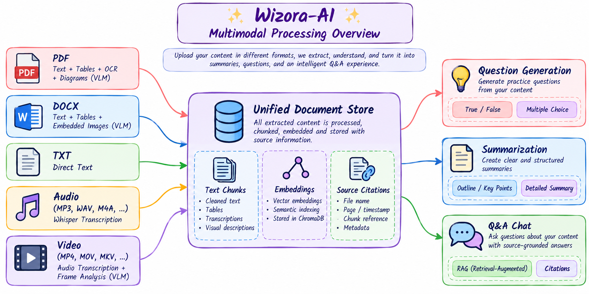
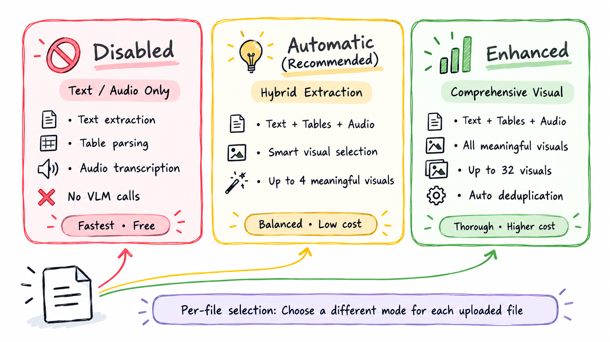
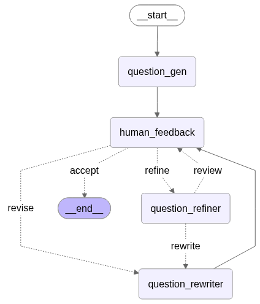
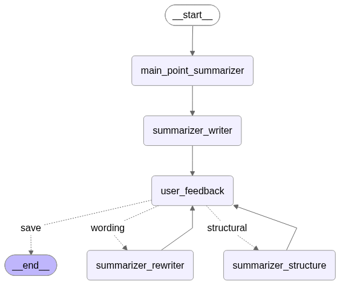
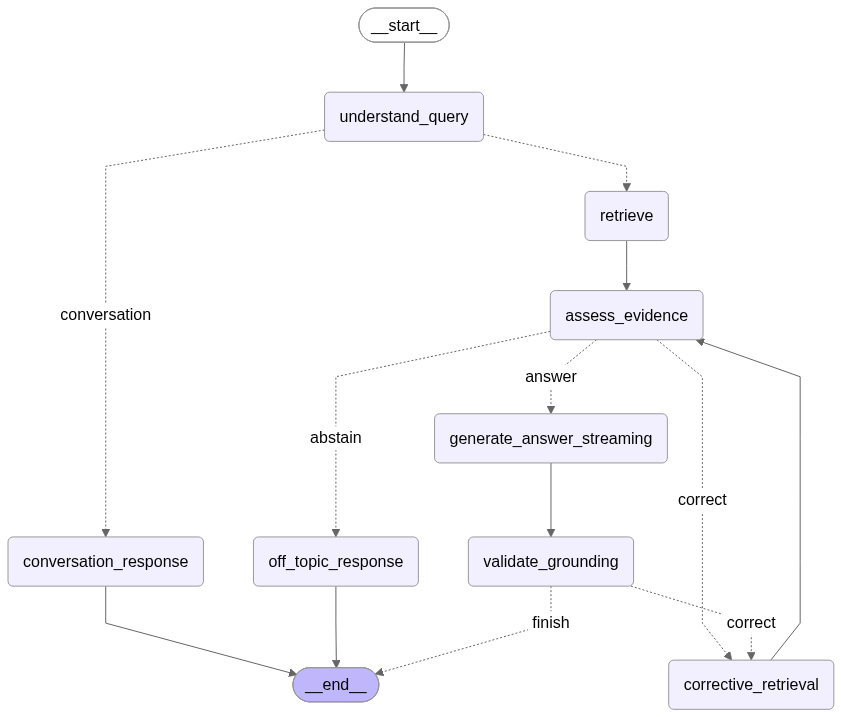

# Wizora-AI - AI Teaching Assistant

Wizora-AI is an Agentic AI-powered multimodal teaching assistant that helps educators process educational content, generate questions, create summaries, and build Q&A systems. It supports text, documents, audio, and video with optional visual understanding through Vision Language Models (VLMs).

## Features

- **Multimodal File Upload**: Upload PDF, DOCX, TXT documents or audio/video files with optional per-file visual processing mode
- **Question Generation**: Create True/False or Multiple Choice questions with three difficulty levels (Easy, Medium, Hard), human-in-the-loop refinement, and automatic AI critique
- **Content Summarization**: Two-stage summarization — extract main points first, then generate a detailed prose summary with iterative feedback
- **Question Answering**: Ask questions and get grounded answers with source citations, conversational memory, and follow-up support
- **Practice Tests**: Take practice quizzes, score answers, and track performance on generated questions
- **Visual Understanding (VLM)**: Analyze diagrams, charts, images in PDFs/DOCX and video frames using Vision Language Models with three processing modes

## Demo

<!-- Demo video will be added here -->

## How It Works

### Multimodal Processing Pipeline

Wizora-AI is a **multimodal system** that processes diverse content types through specialized extraction pipelines:



| Content Type | Extraction Method | Visual Support |
| --- | --- | --- |
| **PDF** | Text + table extraction, optional OCR | Diagrams, charts, figures via VLM |
| **DOCX** | Native text + table parsing, optional rendering | Embedded images via VLM |
| **TXT** | Direct text ingestion | — |
| **Audio** (MP3, WAV, M4A, FLAC, OGG, AAC) | Local Whisper transcription | — |
| **Video** (MP4, MOV, MKV, WEBM, AVI, FLV) | Audio track → Whisper + frame extraction | Scene-based frame analysis via VLM |

### Visual Understanding (VLM) Modes

Each file that supports visuals (PDF, DOCX, video) can be processed in one of **three visual modes**, selectable per file at upload time:



#### 🔴 Disabled — Text / Audio Only
- Extracts text, tables, and audio transcription only
- **No VLM inference** — zero visual-model API calls
- Fastest processing, lowest cost
- Best for: text-heavy documents without meaningful visuals

#### 🟡 Automatic — Hybrid Extraction (Recommended)
- Extracts text, tables, and audio, then **selectively analyzes meaningful visuals**
- Uses heuristics to identify diagrams, charts, and informative images — skips decorative content
- Processes up to a **configurable limit** of meaningful visuals (default: 4 per file)
- Balances processing time and cost with visual understanding
- Best for: documents with some diagrams or charts mixed with text

#### 🟢 Enhanced — Comprehensive Visual Understanding
- Extracts text, tables, and audio, then **analyzes all detected meaningful visuals**
- Lower filtering threshold — captures more visual artifacts
- Processes up to the **full configured limit** of visuals (default: 32 per file)
- Duplicate images and near-identical frames are automatically deduplicated
- Most thorough but highest processing time and cost
- Best for: visual-heavy documents, technical diagrams, video lectures with slides

#### Optional Visual Mode Per File

When uploading multiple files, you can choose a **different visual mode for each file**. For example:
- A text-heavy PDF → **Disabled** (fast, no VLM cost)
- A diagram-rich PDF → **Enhanced** (full visual analysis)
- A video lecture → **Automatic** (smart frame selection)

This per-file control lets you balance processing speed and cost across your content library.

### How Video Is Analyzed

Video processing in Wizora-AI is a **two-stage multimodal pipeline**:

**Stage 1 — Audio Extraction:**
- The audio track is extracted and split into configurable chunks (default: 300 seconds)
- Each chunk is transcribed locally using **OpenAI Whisper** (configurable model size)
- Timestamps are preserved for source citation

**Stage 2 — Frame Extraction (VLM modes only):**

| Step | Automatic Mode | Enhanced Mode |
| --- | --- | --- |
| **Frame Sampling** | Uniform interval sampling (default: every 30s) | Uniform interval + scene-change detection |
| **Scene Detection** | Basic anchors only | FFmpeg scene-change analysis at configurable FPS |
| **Frame Limit** | Up to configured max (default: 12 frames) | Up to configured max with scene-aware distribution |
| **Visual Filtering** | Selects only meaningful frames | Analyzes all meaningful unique frames |
| **VLM Analysis** | Describes selected frames with vision model | Comprehensive description of all frames with context |
| **Deduplication** | Skips near-identical frames | Skips near-identical frames |

The transcription and frame descriptions are combined into a unified document that preserves temporal context and source identity.

---

### Question Generation

#### Question Types

| Type | Format | Example |
| --- | --- | --- |
| **True/False (T/F)** | A statement with a True or False answer | "Neural networks require labeled data for supervised learning." → **True** |
| **Multiple Choice (MCQ)** | A question with 4 options (one correct) | "Which optimizer uses adaptive learning rates?" → A) SGD  B) **Adam**  C) GD  D) Mini-batch |

#### Difficulty Levels

Questions are generated with a **difficulty-aware prompting system** validated by an AI assessment rubric:

| Difficulty | Rubric | What It Tests |
| --- | --- | --- |
| **Easy** | Recall one explicit source fact or definition | Direct recall from the content |
| **Medium** | Apply or explain a supported relationship in a new context | Understanding and application |
| **Hard** | Combine at least two distinct source-supported premises that interact in an inference or multiple reasoning steps | Multi-step reasoning and synthesis |

**Adaptive Difficulty Fallback:** If the source material lacks sufficient depth for Hard questions (e.g., no multi-premise relationships), the system **automatically falls back to Medium** and notifies the user with an explanatory notice. This ensures question quality is never compromised.

#### Human-in-the-Loop Feedback

After each question is generated, you enter a **feedback loop** where you can:

1. **Accept** → Save the question as-is and finish
2. **Provide feedback** → Write specific instructions (e.g., "make the distractors more challenging") → The **question_rewriter** node rewrites the question based on your feedback → Returns for your review
3. **Auto-refine** → The **question_refiner** node automatically critiques and improves the question using AI feedback → Returns for your review

This loop continues until you accept the question, allowing unlimited refinement cycles.

---

### Content Summarization

The summarization pipeline works in **two distinct stages**:

#### Stage 1 — Main Points Extraction
- The **main_point_summarizer** node reads the full source content
- Extracts key points and creates a structured **table of contents / outline**
- This outline guides the detailed summary generation

#### Stage 2 — Detailed Summary Writing
- The **summarizer_writer** node takes the outline and source content
- Generates a comprehensive **prose summary** grounded in the source material
- The summary covers each main point with supporting details and evidence

#### Feedback and Refinement

After the summary is generated, you enter a **feedback loop**:

1. **Save** → Accept the summary as-is
2. **Wording feedback** → The **summarizer_rewriter** node refines the language, tone, or phrasing based on your instructions
3. **Structural feedback** → The **summarizer_structure** node reorganizes sections, reorders points, or restructures the summary layout

Both paths loop back to user feedback, allowing **iterative improvement** until you're satisfied.

---

### Question Answering

The Q&A system uses **grounded retrieval-augmented generation (RAG)** with conversational memory:

- **Query Understanding**: Analyzes your question's intent and relevance to the uploaded content
- **Smart Routing**: Conversational queries (e.g., "What did we discuss?", "List my previous questions") are handled directly from conversation history; content queries go through the retrieval pipeline
- **Semantic Retrieval**: Uses MMR-based search over ChromaDB to find the most relevant document chunks
- **Evidence Assessment**: Evaluates retrieved evidence quality — if insufficient, triggers **corrective retrieval** with expanded search parameters
- **Grounded Answers**: Generates answers strictly from retrieved evidence with source citations
- **Grounding Validation**: Verifies the answer is actually supported by the evidence before returning it

---

## Requirements

- Python 3.11+
- Dependencies managed by `uv` (see `pyproject.toml`)
- FFmpeg (for audio/video processing, bundled via `imageio-ffmpeg`)
- Ollama (optional, for local LLM and vision model support)

## Installation

1. Clone this repository:
   ```bash
   git clone https://github.com/MarouaHattab/Wizora-AI.git
   cd Wizora-AI
   ```

2. Install `uv` (if not already installed):

   **Windows:**
   ```powershell
   powershell -ExecutionPolicy ByPass -c "irm https://astral.sh/uv/install.ps1 | iex"
   ```

   **Linux/macOS:**
   ```bash
   curl -LsSf https://astral.sh/uv/install.sh | sh
   ```

3. Install the required Python packages:
   ```bash
   uv sync --frozen
   ```

4. (Optional) Install Ollama for local LLM and vision model support:

   **Windows/macOS/Linux:**
   - Download and install from https://ollama.ai/
   - Or use the installation script:

   ```bash
   curl -fsSL https://ollama.ai/install.sh | sh
   ```

   **Pull the recommended vision model:**

   ```bash
   ollama pull qwen3.5:2b
   ```

5. Set up your environment variables (API keys, etc.) in a `.env` file.

   **Update `.env` with your credentials:**
   ```bash
   cp .env.example .env
   ```

## Usage

### Running the Application

1. Start the FastAPI backend:
   ```bash
   uv run python main.py
   ```

2. In a separate terminal, start the Gradio UI:
   ```bash
   uv run python gradio_ui.py
   ```

3. Open [Wizora-AI](http://127.0.0.1:7860) in your browser and the [API Documentation](http://127.0.0.1:8000/docs).

## Architecture

Wizora-AI uses a microservice architecture with agent-based workflows:

- **FastAPI backend** for API endpoints
- **LangChain-based processing pipelines** with multi-agent workflows
- **LangGraph** for LLM orchestration and stateful agent graphs
- **ChromaDB** for vector storage and semantic retrieval
- **Local Whisper** for audio transcription
- **Vision Language Models** (Ollama, Google, NVIDIA) for visual understanding

### Agent Graph Architecture

Wizora-AI implements three main agent graphs, each designed with specific nodes, loops, and reflection mechanisms:

#### 1. Question Generation Graph


The Question Generation agent follows a human-in-the-loop pattern with reflection capabilities:

**Nodes:**
- **question_gen**: Initial question creation from content with difficulty-aware prompting
- **human_feedback**: Human interaction node with interrupt mechanism
- **Router**: Decision node that routes based on feedback type (`accept`, `refine`, `revise`)
- **question_refiner**: Automatic refinement using AI critique and feedback
- **question_rewriter**: Manual refinement based on human feedback

**Flow:**
- Starts with question generation from uploaded content
- Enters human feedback loop with interrupt
- Router decides: `accept` (END), `refine` (question_refiner), or `revise` (question_rewriter)
- Refiner routes to either `review` (human_feedback) or `rewrite` (question_rewriter)
- Rewriter loops back to human feedback for continuous improvement
- Supports adaptive difficulty fallback (Hard → Medium) when source material lacks depth

#### 2. Content Summarization Graph


The Summarization agent uses a two-stage approach with iterative refinement:

**Nodes:**
- **main_point_summarizer**: Extracts key points and creates table of contents
- **summarizer_writer**: Generates detailed summary from main points
- **user_feedback**: Human review and feedback collection with interrupt
- **summarizer_rewriter**: Refines summary wording based on feedback
- **summarizer_structure**: Restructures summary organization based on feedback
- **Router**: Routes to `save` (END), `wording` (rewriter), or `structural` (structure)

**Flow:**
- Sequential processing: Main Points → Summary Writer → User Feedback
- Feedback loop: Router directs to rewriter, restructurer, or completion
- Both rewriter and restructurer loop back to user feedback for iterative improvement

#### 3. Question Answering Graph


The Q&A agent implements intelligent query understanding, grounded retrieval, and conversational memory:

**Nodes:**
- **understand_query**: Analyzes question intent, relevance, and conversation context
- **query_router**: Routes based on query type (`conversation` or `retrieve`)
- **conversation_response**: Handles conversational meta-queries (history recall, recaps)
- **retrieve**: Fetches relevant document chunks using semantic search (MMR)
- **assess_evidence**: Evaluates retrieved evidence quality and relevance
- **evidence_router**: Routes to `answer`, `correct` (corrective retrieval), or `abstain`
- **generate_answer_streaming**: Creates grounded answers with citations from retrieved content
- **corrective_retrieval**: Re-retrieves with expanded parameters when evidence is insufficient
- **validate_grounding**: Verifies answer is grounded in source evidence
- **off_topic_response**: Handles questions outside the content scope

**Flow:**
- Query understanding with conversation history awareness
- Conditional routing: conversational queries get direct responses; content queries go through retrieval pipeline
- Evidence assessment with corrective retrieval loop for insufficient evidence
- Answer generation with grounding validation
- Off-topic questions receive appropriate redirect responses

### Key Architectural Features

**Human-in-the-Loop Design:**
- Strategic interrupt points for human feedback
- Continuous refinement loops in generation and summarization
- User control over when to complete or continue refining

**Reflection Agent Architecture:**
- AI critique and feedback incorporation mechanisms
- Revision history tracking for context preservation
- Iterative improvement through dedicated refiner/rewriter nodes
- Adaptive difficulty fallback for question generation

**Grounded Retrieval (RAG):**
- MMR-based semantic search with configurable parameters
- Corrective retrieval passes for insufficient evidence
- Answer grounding validation with citation tracking
- Near-duplicate detection and evidence deduplication

### Async API Architecture

Wizora-AI implements a comprehensive async API architecture that supports both synchronous and streaming responses, providing real-time user experiences and efficient resource utilization.

## API Documentation

### File Processing APIs

#### 1. Upload File
Upload PDF, DOCX, TXT documents or audio/video files for text extraction and processing.

**URL:** `/upload_file/`

**Method:** `POST`

**Content-Type:** `multipart/form-data`

**Request Body:**
```
file: Upload file (PDF, DOCX, TXT, audio, or video format)
```

**Response:**
```json
{
  "message": "File processed successfully",
  "id": "uuid-string",
  "text_path": "path/to/extracted_text.txt",
  "original_file_path": "path/to/original_file"
}
```

**Supported Formats:**
- **Documents**: `.pdf`, `.docx`, `.txt` files
- **Audio**: `.mp3`, `.wav`, `.m4a`, `.flac`, `.ogg`, `.aac` formats
- **Video**: `.mp4`, `.mov`, `.mkv`, `.webm`, `.avi`, `.flv` formats

---

#### 2. Get Extracted Text
Retrieve the processed text content for a given asset ID.

**URL:** `/get_extracted_text/{asset_id}`

**Method:** `GET`

**Path Parameters:**
- `asset_id`: The unique identifier returned from file upload

**Response:**
```json
{
  "asset_id": "uuid-string",
  "extracted_text": "Full text content..."
}
```

---

### Question Generation APIs

#### 3. Start Question Generation Session
Generate questions from uploaded content with human-in-the-loop feedback.

**URL:** `/api/v1/graph/qg/start_session`

**Method:** `POST`

**Request Body:**
```jsonc
{
  "asset_id": "uuid-string",
  "question_type": "T/F",  // or "MCQ"
  "difficulty": "medium"   // "easy", "medium", or "hard"
}
```

**Parameters:**
- `asset_id`: Asset ID from file upload (required)
- `question_type`: Question type - "T/F" for True/False or "MCQ" for Multiple Choice (required)
- `difficulty`: Difficulty level - "easy", "medium", or "hard" (optional, defaults to "medium")

**Response:**
```jsonc
{
  "thread_id": "uuid-string",
  "status": "interrupted_for_feedback",
  "data_for_feedback": {
    "generated_question": "string",
    "options": ["string"],  // or null for T/F
    "answer": "string",
    "explanation": "string",
    "difficulty": "medium",
    "source_scope": "string",
    "source_citations": ["string"]
  },
  "current_state": {}
}
```

---

#### 4. Provide Question Feedback
Provide feedback to refine generated questions or save the current question.

**URL:** `/api/v1/graph/qg/provide_feedback`

**Method:** `POST`

**Request Body:**
```json
{
  "thread_id": "uuid-string",
  "feedback": "string"
}
```

**Parameters:**
- `thread_id`: Session ID from start_session (required)
- `feedback`: Feedback text, "auto" for automatic refinement, or "save" to finish (required)

**Response:**
```jsonc
{
  "thread_id": "uuid-string",
  "status": "completed",  // or "interrupted_for_feedback"
  "final_state": {}  // or null
}
```

---

#### 5. Edit Question
Directly edit a generated question without going through the feedback loop.

**URL:** `/api/v1/graph/qg/edit_question`

**Method:** `POST`

**Request Body:**
```json
{
  "thread_id": "uuid-string",
  "review_id": "uuid-string",
  "question": "string",
  "options": ["string"],
  "answer": "string",
  "explanation": "string"
}
```

---

### Content Summarization APIs

#### 6. Start Summarization Session (Streaming)
Generate content summaries with real-time streaming output.

**URL:** `/api/v1/graph/summarizer/start_session_streaming`

**Method:** `POST`

**Content-Type:** `text/event-stream`

**Request Body:**
```json
{
  "asset_id": "uuid-string"
}
```

**Parameters:**
- `asset_id`: Asset ID from file upload (required)

**Streaming Response Events:**
```
data: {"thread_id": "uuid", "status": "starting_session"}
data: {"event": "token", "token": "text", "status_update": "main_point_summarizer"}
data: {"event": "token", "token": "text", "status_update": "summarizer_writer"}
data: {"event": "stream_end", "thread_id": "uuid", "status_update": "Stream ended"}
```

---

#### 7. Provide Summarization Feedback (Streaming)
Refine summaries based on user feedback with streaming responses.

**URL:** `/api/v1/graph/summarizer/provide_feedback_streaming`

**Method:** `POST`

**Content-Type:** `text/event-stream`

**Request Body:**
```json
{
  "thread_id": "uuid-string",
  "feedback": "string"
}
```

**Parameters:**
- `thread_id`: Session ID from start_session_streaming (required)
- `feedback`: Feedback text or "save" to finish (required)

**Streaming Response Events:**
```
data: {"thread_id": "uuid", "status": "resuming_with_feedback"}
data: {"event": "token", "token": "text", "status_update": "summarizer_rewriter"}
data: {"event": "stream_end", "thread_id": "uuid", "status_update": "Stream ended"}
```

---

### Question Answering APIs

#### 8. Start Q&A Session (Streaming)
Answer questions based on uploaded content with streaming responses.

**URL:** `/api/v1/graph/qa/start_session_stream`

**Method:** `POST`

**Content-Type:** `text/event-stream`

**Request Body:**
```json
{
  "asset_id": "uuid-string",
  "initial_question": "string"
}
```

**Parameters:**
- `asset_id`: Asset ID from file upload (required)
- `initial_question`: The first question to ask about the content (required)

**Streaming Response Events:**
```
data: {"type": "metadata", "thread_id": "uuid", "asset_id": "uuid"}
data: {"type": "token", "content": "answer text..."}
data: {"type": "complete", "answer_status": "answered", "citations": [], "grounding": "verified"}
```

---

#### 9. Continue Q&A Conversation (Streaming)
Continue an existing Q&A session with follow-up questions.

**URL:** `/api/v1/graph/qa/continue_conversation_stream`

**Method:** `POST`

**Content-Type:** `text/event-stream`

**Request Body:**
```json
{
  "thread_id": "uuid-string",
  "next_question": "string"
}
```

**Streaming Response Events:**
```
data: {"type": "metadata", "thread_id": "uuid"}
data: {"type": "token", "content": "answer text..."}
data: {"type": "complete", "answer_status": "answered", "citations": [], "grounding": "verified"}
```

---

### Utility APIs

#### 10. Provider Status
Check the status and availability of configured LLM providers.

**URL:** `/api/v1/providers/status`

**Method:** `GET`

**Response:** Provider metadata and connectivity status for all configured providers.

---

#### 11. Session Management
List and inspect active graph sessions.

**URL:** `/api/v1/sessions/question_generation`

**Method:** `GET`

**URL:** `/api/v1/sessions/{workflow}/{thread_id}`

**Method:** `GET`

---

### Headers for Streaming APIs

**Required Headers:**
```
Accept: text/event-stream
Cache-Control: no-cache
Connection: keep-alive
```
